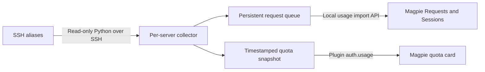

# Magpie SSH Monitor

[简体中文](README.zh-CN.md)

Monitor remote Codex quota snapshots and session token usage in [Magpie](https://github.com/yetone/magpie), from your Mac.

Add your own SSH aliases from the command line. Each server gets a separate Magpie quota card, an `SSH-<alias>` usage filter, persistent import state, and a background collector. No service is installed on the SSH server.

## Requirements

- macOS, Python 3.9+, and Magpie installed and running. Tested with Magpie 0.1.1246.
- A working, non-interactive SSH alias: `ssh -o BatchMode=yes devbox true`.
- Python 3.9+ on the server, and Codex JSONL logs containing explicit `token_usage_record` records.

There are no Python or npm dependencies. Magpie runs its plugin adapter with its own Bun runtime.

## Quick start

```sh
git clone https://github.com/meii11/magpie-ssh-monitor.git
cd magpie-ssh-monitor
python3 manage.py add devbox --name "Dev box"
```

`devbox` must be your SSH alias. Configure addresses, users, identity files, jump hosts and ports with your normal `~/.ssh/config`; the monitor does not copy or manage SSH credentials.

Add another server with the same command:

```sh
python3 manage.py add buildbox --name "Build server" --interval 120
python3 manage.py list
python3 manage.py status devbox
python3 manage.py sync devbox
```

The CLI copies the runtime into Application Support, reads and imports real remote metadata, registers the local Magpie plugin, and installs a per-server LaunchAgent. Source checkout location does not affect background collection.

**Use the CLI to install.** Adding the unconfigured source repository directly in Magpie does not set up an SSH collector. The installer creates a configured plugin for each server.

## View the results

- **Usage → Overview:** `<display name> · Codex SSH` quota card.
- **Usage → Requests:** select the `SSH-<alias>` agent.
- **Usage → Sessions:** remote session IDs start with `<alias>/`.

Initial history is the last 7×24 hours by default, then imports are incremental. Magpie's “7 days” filter uses calendar days, so its visible count may differ from the initial import total. Imported usage can include child threads as independent sessions.

## Options

```sh
python3 manage.py add devbox \
  --name "Dev box" \
  --remote-dir "~/.codex/sessions" \
  --gateway http://127.0.0.1:3425 \
  --interval 60 \
  --days 7
```

- `--remote-dir`: remote session directory; absolute paths and `~/` paths are supported, including spaces.
- `--gateway`: local Magpie endpoint. Only `http://127.0.0.1:PORT` is accepted.
- `--interval`: 5–86400 seconds; defaults to 60. Snapshot freshness checks follow this interval.
- `--days`: first import window, 1–3650 days; defaults to 7.
- `--magpie /path/to/magpie`: explicitly select the Magpie CLI.
- `--manual`: register the plugin without a LaunchAgent; run `sync` yourself.
- `--root`: global option for a separate private state root; place it before the command.

```sh
python3 manage.py --root "$HOME/Library/Application Support/MySSHMonitors" add devbox
```

## Update and remove

```sh
git pull
python3 manage.py update devbox
python3 manage.py remove devbox
```

`update` installs the current checkout's code for that server and preserves its identity, counters and history boundary. `remove` stops its LaunchAgent and unregisters its plugin. Local state and already imported Magpie history are retained. Re-adding the same alias resumes the same state.

## Data and accuracy

- Quotas are **timestamped log snapshots**, not live account queries. No new Codex request means no new quota observation. Expired windows are never invented as unused quota.
- Uses explicit request IDs in `token_usage_record` and compaction metadata. Repeated records and import retries are deduplicated. Cumulative token counters are never summed as requests.
- Resolves models by executing thread and turn ID, including child-thread records stored under a parent session. Unknown or conflicting identities are reported instead of guessed.
- Cached input is separated from uncached input; reasoning tokens remain part of output.
- Only recorded usage is imported. HTTP 200 in reported rows denotes an observed usage record, not captured HTTP traffic; this is not a full request/error/latency monitor.
- Magpie estimates API-equivalent costs at its model prices. These are not charges to a subscription; unknown prices remain unpriced.
- Compressed `.jsonl.zst` files in the selected scan range are not supported. Unsupported files cause an explicit error. Old log formats without explicit request records are not reconstructed.

Only IDs, models, token counts, quota windows and timestamps cross SSH. Prompts, replies, tool output, credentials and unknown record fields are not exported. This project has no telemetry and never calls a model API.

State lives under `~/Library/Application Support/MagpieSSHMonitor`, with per-server databases, cursors, generated plugins and bounded logs. Generated configuration, database files, snapshots and local work notes are excluded from Git. Magpie configuration is backed up locally before plugin registration/removal.

## How it works



## Development

```sh
python3 -m unittest discover -s tests -v
node --test tests/*.test.mjs
```

Issues and pull requests are welcome. Include the relevant error, client/server versions, and a minimal sanitized log record. Do not attach credentials, raw conversations, or your local state database.

Integration uses Magpie's [plugin hooks](https://usemagpie.ai/docs/plugins) and [public usage import API](https://github.com/yetone/magpie/blob/main/docs/reference.md). This is an independent community project. [MIT licensed](LICENSE).
